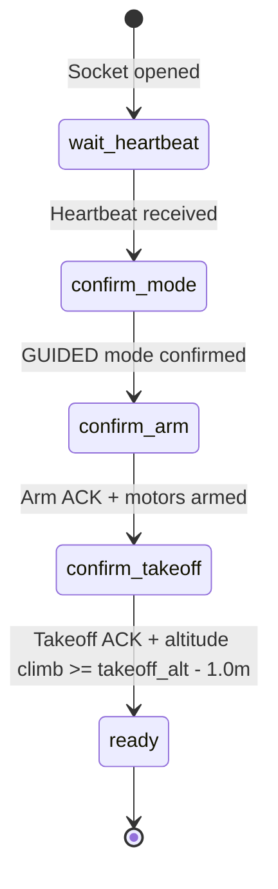
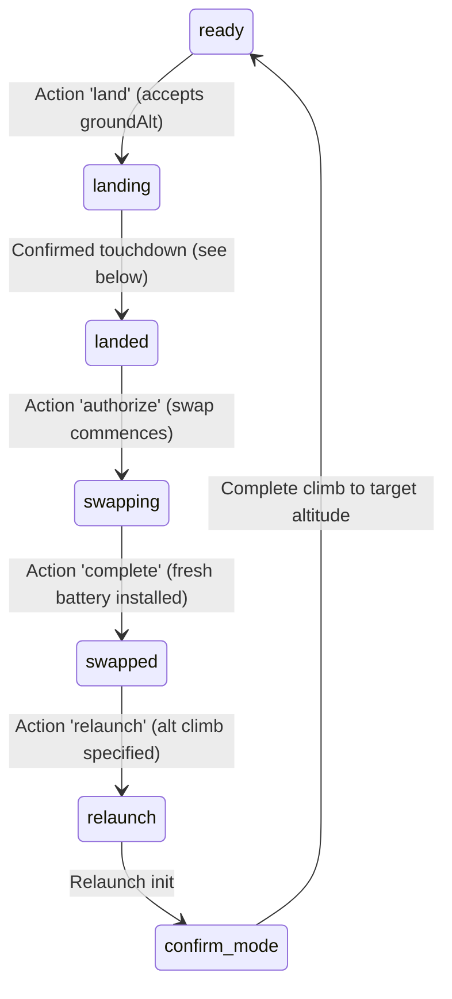
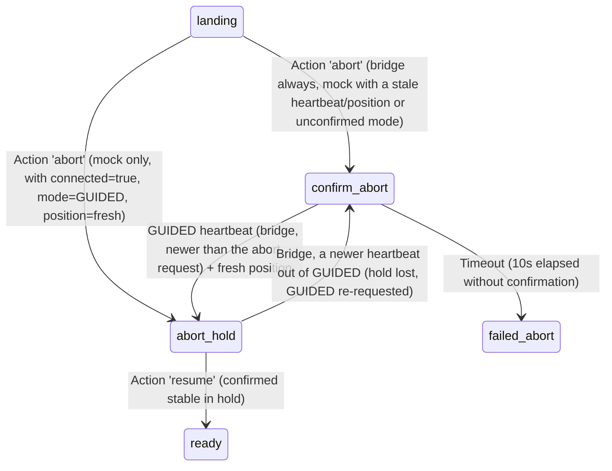

# Browser–Bridge Protocol Specification

Version: 1.2 (October 2026)
Scope: Communication contract between the web-based swarm simulator (`js/external.js`) and external vehicle servers (`sitl/bridge.py` and `sitl/mock_vehicles.py`).

---

## 1. Overview and Architecture

The simulator supports flying simulated or real physical drones via an external bridge over a single full-duplex WebSocket connection.

```
+-------------------+        WebSocket JSON       +-----------------------+
|                   |  <----------------------->  |                       |
|   Browser Sim     |     ws://localhost:8765     |  sitl/bridge.py       | <== MAVLink ==> SITL / Real Autopilots
| (js/external.js)  |                             |  sitl/mock_vehicles.py| (simulated point-mass dynamics)
+-------------------+                             +-----------------------+
```

Both server implementations MUST adhere strictly to this specification to ensure interoperability and prevent behavioral drift. Where the two servers intentionally differ, the difference is called out below.

### 1.1 Handshake
Both servers (and `sitl/tak_bridge.py`) gate the WebSocket handshake with `sitl/ws_origin.py`, before any message is read:
- A handshake whose `Origin` header is not loopback `http(s)` (`localhost`, `127.0.0.1`, `[::1]`, any port), `null` (what a page opened from `file://` sends) or `https://dalailalama.github.io`, nor one added with `--allow-origin`, gets HTTP 403. A handshake with no `Origin` header (a non-browser client) passes this check.
- With `--token SECRET` (or `$BRIDGE_TOKEN`) the handshake URL must carry `?token=SECRET`, e.g. `ws://host:8765/?token=SECRET` typed into the sim's Bridge URL field, or it gets HTTP 401. A server bound beyond loopback without a token generates one and prints it.

---

## 2. Coordinate Systems and Frames

### 2.1 Simulation Local Frame (`sim`)
- **X**: East, metres (positive right on standard canvas).
- **Y**: South, metres (positive down on standard canvas).
- **Alt**: Metres above the origin ground elevation `origin.groundM` (positive up). This equals height above ground only over flat terrain.

### 2.2 Autopilot Local Frame (`LOCAL_NED`)
- **North**: Metres North (`-sim.y`).
- **East**: Metres East (`+sim.x`).
- **Down**: Metres Down (`-sim.alt` relative to origin elevation).

### 2.3 Common Local Origin
At connection/initialization time, the browser captures an immutable common local origin and sends it in `init`:
```json
{
  "frame": "common-local-origin",
  "x": 1000.0,
  "y": 500.0,
  "groundM": 250.0
}
```
All goal commands sent by the browser are origin-relative. All telemetry coordinates returned by the server are origin-relative: servers report the autopilot's local NED position converted to the sim frame and only echo the origin back; the browser adds `origin.x`/`origin.y`/`origin.groundM` to place the vehicle in the world.

---

## 3. Wire Protocol Messages

All messages are JSON objects with a mandatory `"type"` string field. The fenced `json` examples in this section are checked key-for-key against both servers by `sitl/test_protocol_conformance.py`; change them together with the code.

### 3.1 Client to Server Messages

#### `init`
Requests initialization and allocation of vehicles, and fixes the common local origin (§2.3) for the session.
```json
{
  "type": "init",
  "count": 5,
  "alt": 30.0,
  "origin": { "frame": "common-local-origin", "x": 1000.0, "y": 500.0, "groundM": 250.0 }
}
```
- `count` (integer $\ge 0$): Number of vehicles to initialize (`DR-1` through `DR-N`).
- `alt` (float): Takeoff altitude in metres above each vehicle's launch point; must be above 1.0 m (`TAKEOFF_CONFIRM_ALT_M`).
- `origin` (object): The browser always sends it. When it is absent both servers use the zero origin.
- Both servers refuse an `init` whose `count` or `alt` is not a finite number, whose `alt` is 1.0 m or less, or whose `origin` is malformed (wrong `frame`, or non-finite `x`/`y`/`groundM`), with a `status` line, before it can take control.
- An `init` is not a teardown. A vehicle it still lists keeps its link, flight and service state: a flying vehicle keeps flying, and one parked in a service phase stays parked (its `ready` entry and telemetry `state` name the phase); only the §5.2 handshake arms it again. The browser picks a parked vehicle's service up from telemetry (`serviceId`, phases `landing` to `swapped`) and finishes it. `positionSeq` and `landedSeq` never restart for an id, also for one that leaves the fleet and comes back. A vehicle the `init` drops leaves telemetry at once; the bridge first commands one that last reported armed to LAND and keeps watching it until it is down (an id that returns meanwhile comes back in that landing service), while the mock, having no aircraft, simply removes it.

#### `goals`
Commands waypoint setpoints for active vehicles. The browser sends them at about 2 Hz (at most once per 0.5 s of sim time).
```json
{
  "type": "goals",
  "goals": [
    { "id": "DR-1", "x": 120.5, "y": -45.0, "alt": 30.0 },
    { "id": "DR-2", "x": 150.0, "y": -30.0, "alt": 30.0 }
  ]
}
```
- Goals for unknown, unready, disconnected, or servicing vehicles MUST be safely ignored.

#### `service`
Commands lifecycle and service transitions (landing, battery swap, relaunch, abort, resume).
```json
{
  "type": "service",
  "id": "DR-1",
  "requestId": "svc-92a4f10",
  "action": "land",
  "groundAlt": 0.0
}
```
- `id` (string): Vehicle identifier.
- `requestId` (string): Unique token identifying this service transaction.
- `action` (string): One of `"land"`, `"authorize"`, `"complete"`, `"relaunch"`, `"abort"`, `"resume"`.
- `groundAlt` (optional float, `"land"`): Terrain elevation under the vehicle relative to `origin.groundM`. The mock descends to it; the bridge ignores it and lets the autopilot's LAND mode find the ground (§5.2).
- `alt` (float, required for `"relaunch"`): Climb in metres above the touchdown point (`takeoff_alt = launch_alt + alt`). A missing, non-numeric or non-finite `alt`, or one of 1.0 m or less, is rejected with `BAD_ALTITUDE` (not retryable).

---

### 3.2 Server to Client Messages

#### `ready`
Sent in response to `"init"`. The bridge waits (bounded) for each vehicle's first-pass outcome before replying, and keeps answering the client's `goals` and `service` messages meanwhile (a newer `init` supersedes a reply still waiting); the mock replies at once, with each new vehicle in `wait-heartbeat` and each vehicle the `init` kept (§3.1) in its current state. Later per-vehicle progress arrives in telemetry.
```json
{
  "type": "ready",
  "ids": ["DR-1", "DR-2"],
  "vehicles": [
    { "id": "DR-1", "ready": true, "state": "ready" },
    { "id": "DR-2", "ready": false, "state": "confirm-arm" }
  ]
}
```
- `ids` is the fleet that exists. When it is shorter than the `init` count (the bridge was started with `--count`, which overrides the message's count, or the count exceeded `MAX_VEHICLES` = 256, which both servers clamp to; either is said in a `status` line), the browser marks every drone not in `ids` down at once and reports readiness against the count it asked for (e.g. `3/10`). A listed vehicle that never sends telemetry goes down after `EXT_LOST_DEAD_SEC`.

#### `telemetry`
Broadcast periodically (10 Hz) with the live state of all vehicles. `t` is server-monotonic seconds since start.
```json
{
  "type": "telemetry",
  "t": 12.35,
  "vehicles": [
    {
      "id": "DR-1",
      "x": 12.0,
      "y": -8.0,
      "alt": 30.0,
      "connected": true,
      "ready": true,
      "state": "ready",
      "armed": true,
      "heartbeatAge": 0.1,
      "positionAge": 0.05,
      "positionSeq": 42,
      "landed": false,
      "landedAge": 0.1,
      "landedSeq": 7,
      "serviceId": null,
      "servicePhase": null,
      "origin": { "frame": "common-local-origin", "x": 0.0, "y": 0.0, "groundM": 0.0 }
    }
  ]
}
```
- `x`, `y`, `alt`: local position in the sim frame (§2.1), origin-relative; `origin` is the `init` origin echoed back.
- `heartbeatAge`, `positionAge`, `landedAge` (seconds, or `null` before the first sample) and `positionSeq`, `landedSeq` (integers, 0 = never sampled) describe sample freshness. On the bridge `landed` is `null` until the autopilot has sent a landed-state sample; the mock always reports a boolean.
- `state` is the per-vehicle state string: the §5.1 init states (`wait-heartbeat`, `confirm-mode`, `confirm-arm`, `confirm-takeoff`, `ready`), the §5.2/§5.3 service states (`landing`, `landed`, `swapping`, `swapped`, `confirm-abort`, `abort-hold`, `aborted`), or `failed:<step>`. Bridge only: `mode-lost:<custom_mode>` and `disarmed` (READY revoked, §5.1), `failed:connect` (its UDP port could not be bound) and `failed:unsupported-autopilot` (a PX4 heartbeat; the bridge drives ArduCopter only).
- What the browser (`js/external.js`) requires before acting:
  - **goals** go to a vehicle only while `connected === true`, `positionSeq > 0` with a fresh `positionAge` (< 3 s), `ready === true`, `state === "ready"` and `armed === true`;
  - **touchdown** (and so the `"authorize"` that follows a `"land"`) additionally needs `armed === false`, a fresh `heartbeatAge`, `landed === true`, `landedSeq > 0` and a fresh `landedAge`. A server that omits `landedSeq`/`landedAge` never completes a battery swap.

#### `service_ack`
Machine-readable acknowledgment sent for every `"service"` message from the controlling client. An accepted request:
```json
{
  "type": "service_ack",
  "requestId": "svc-92a4f10",
  "id": "DR-1",
  "action": "land",
  "accepted": true,
  "duplicate": false
}
```
A rejection adds `retryable`, and `code`/`error` when the server has them:
```json
{
  "type": "service_ack",
  "requestId": "svc-92a4f10",
  "id": "DR-1",
  "action": "authorize",
  "accepted": false,
  "duplicate": false,
  "code": "INVALID_PHASE",
  "error": "cannot authorize in phase landing",
  "retryable": true
}
```
- `accepted` (boolean): Whether the request was validated and adopted.
- `duplicate` (boolean): `true` if this `(requestId, action)` was previously processed and accepted; the original outcome is replayed, with the same keys from both servers. An `init` drops a vehicle's cached outcomes unless it is parked in `landing` to `swapped` (a reloaded page numbers its requests from 1 again), and a vehicle that falls back from `failed` to `landed` drops those of `authorize`, `complete` and `relaunch`, so the handshake can run again (§5.2).
- `code` (string, optional): Machine-readable error code on failure (e.g. `INVALID_PHASE`, `INVALID_REQUEST_ID`, `SERVICE_BUSY`, `HOLD_NOT_READY`, `VEHICLE_NOT_READY`, `BAD_ALTITUDE`).
- `retryable` (boolean, on rejections): `true` if the failure is temporary and can succeed on vehicle state change. Only accepted outcomes are cached for duplicate replay.
- `error` (string, optional): Human-readable diagnostic description.

#### `status`
Advisory informational or diagnostic log text.
```json
{
  "type": "status",
  "msg": "vehicle DR-1: abort confirmed in GUIDED, holding at (120.0, 80.0, 10.0)"
}
```

---

## 4. Freshness and Timing Rules

| Constant | Value | Purpose |
|---|---|---|
| `HEARTBEAT_STALE_S` | 3.0 s | Max allowed age of vehicle heartbeat before link is declared dead / disconnected |
| `POSITION_STALE_S` | 3.0 s | Max allowed age of vehicle position before position is declared stale |
| `INIT_STEP_TIMEOUT_S`| 10.0 s | Timeout before unconfirmed lifecycle step fails (transitions to `failed:<step>`) |
| `STEP_RESEND_DT` | 2.0 s | Interval between re-sending unconfirmed MAVLink commands (e.g. mode, arm) |
| `EXT_LOST_DEAD_SEC` | 10.0 s | Browser simulation time after stale loss before a missing drone is marked `dead` |
| `SERVICE_THROTTLE_S`| 0.5 s | Browser rate limit between retries of identical service actions |
| `MAX_SERVICE_RETRIES`| 5 attempts| Browser maximum retries before transitioning service transaction to `failed` |

---

## 5. Lifecycle and Service State Machine

### 5.1 Initialization Flow


Bridge only: a `ready` vehicle whose own heartbeats report a mode other than GUIDED, or disarmed, on 2 consecutive heartbeats (`READY_REVOKE_HEARTBEATS`: an autopilot failsafe such as RTL or LAND, or a pilot taking over) loses `ready`, with `state` `mode-lost:<custom_mode>` or `disarmed`. The bridge never re-commands it (no GUIDED request, arm or takeoff), and an `init` keeps it in that state.

### 5.2 Battery Swap Handshake


The bridge re-sends `MAV_CMD_NAV_LAND` every `STEP_RESEND_DT` until the autopilot ACKs it. A landing that fails anyway (rejected, or no descent progress for `INIT_STEP_TIMEOUT_S`: `state` `failed:land`, `servicePhase` `failed`) may be retried with a fresh `land` under a new `requestId` while the vehicle is still armed and reporting; both servers accept it. The browser reports the failure and retries after 3 s, up to 3 attempts in all. If the vehicle touches down anyway and the server reports it `landed` again under that landing's `requestId` (including when the retry was refused because the vehicle was already down), the browser carries on with `authorize` as after a normal touchdown.

A relaunch whose mode, arm or climb step fails parks the vehicle (`state` `failed:<step>`, `servicePhase` `failed`). Neither server retries it; once the vehicle again shows the touchdown evidence below it returns to `landed`, from where `authorize`, `complete` and `relaunch` (same `requestId`) can be repeated. The browser reports a refused relaunch and, once the vehicle is back in `landed`, repeats `authorize`, `complete` and `relaunch` under the same `requestId` after 3 s, up to 3 relaunches in all; after the third refusal it reports the vehicle left on the pad and stops.

The browser asks for `land` when the drone's own navigation belief is within 25 m (`DRONE.landThresholdM`) of the base it last learned, the rule the internal physics uses, not the live base. It sends `authorize` only when the vehicle's telemetry shows it set down within 25 m of the true base, where the ground crew is: a vehicle that landed at a stale last-known home gets no battery swap and stays `landed`.

Touchdown is decided differently by the two servers:
- **bridge**: the autopilot reports `EXTENDED_SYS_STATE.landed_state == MAV_LANDED_STATE_ON_GROUND` and a disarmed heartbeat. `groundAlt` is not used.
- **mock**: `|alt - groundAlt| <= 0.05` m, which also disarms the simulated vehicle.

### 5.3 In-Flight Abort Handshake


- The bridge never takes its latest heartbeat as confirmation: it may predate a `NAV_LAND` that already switched the autopilot to LAND, so an airborne abort always passes through `confirm-abort` and re-requests GUIDED every `STEP_RESEND_DT` until a newer heartbeat confirms it. The mock, whose mode changes at once, holds immediately while its heartbeat and position are fresh.
- `abort` is accepted in service phases `landing`, `landed`, `swapping`, `swapped`, `relaunch` and `failed`; anything else gets `INVALID_PHASE`.
- While in `confirm-abort` or `abort-hold`, all mission goals are strictly suppressed.
- An `abort` of a grounded vehicle (landed, swapping or swapped, disarmed) parks it in `aborted`. `resume` refuses it (`CANNOT_RESUME_GROUNDED`, "relaunch required") and `relaunch` is accepted from there exactly as from `swapped`.
- No automatic arming or takeoff commands may be issued from `abort-hold` or `aborted`.

---

## 6. Conformance & Drift Prevention Requirements

`sitl/test_protocol_conformance.py` runs the same checks against `sitl/bridge.py` and `sitl/mock_vehicles.py`:
1. The key sets of `ready` (envelope and per-vehicle entry) and `telemetry` (envelope and per-vehicle object) equal the §3.2 examples exactly. Every `service_ack` either server sends in the suite (accepted, duplicate, rejected) carries the accepted example's keys and no key outside the two examples. The mock is also driven with the §3.1 `init` example.
2. Idempotent duplicate request suppression for accepted actions.
3. Stale heartbeat gating: an abort with an expired heartbeat enters `confirm-abort` and commands no hold until fresh heartbeat evidence arrives (`abort-hold`).
4. Elevation datum conversion for relaunch (`takeoff_alt = launch_alt + requested_alt`).
5. READY only at `takeoff_alt - 1.0 m`.
6. A grounded abort exits through `relaunch` (§5.3).
7. Shared failure semantics: a re-init keeps an airborne vehicle where it is; a relaunch whose arm the autopilot refuses parks the vehicle (`failed:arm`, never re-armed); an abort whose GUIDED request is refused never reports `abort-hold`. The mock models the refusals with its `arm_refused` and `stuck_mode` vehicle flags, and switches to LAND mode on `land` as ArduCopter does. The duplicate-replay `service_ack` carries the same keys from both servers.

Not covered by this suite: non-caching of retryable rejections and touchdown detection (exercised per server in `sitl/test_bridge.py` and `sitl/test_mock_vehicles.py`), and the server differences called out in §3 and §5.2.
